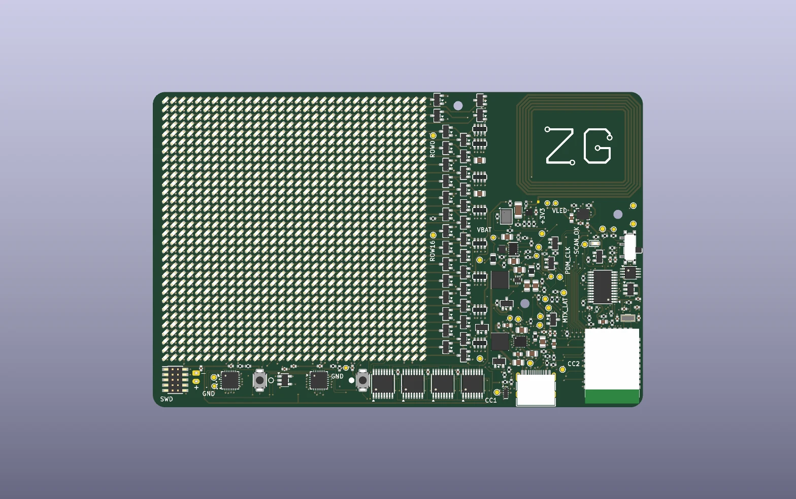
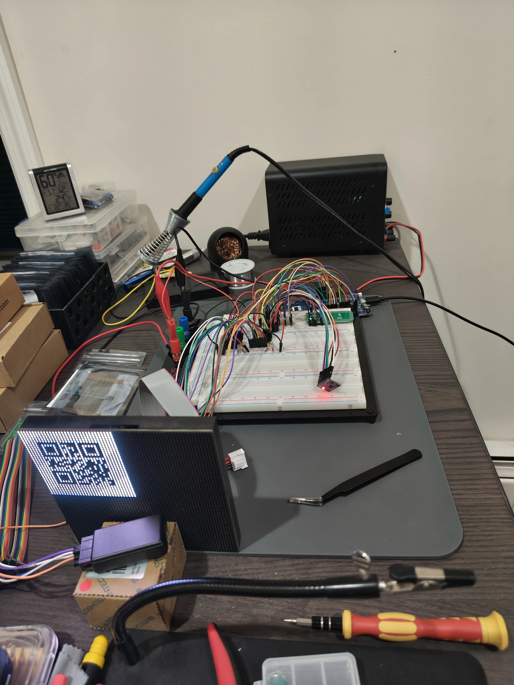
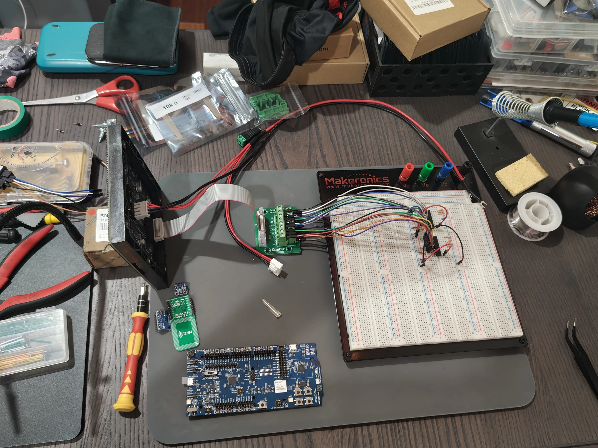
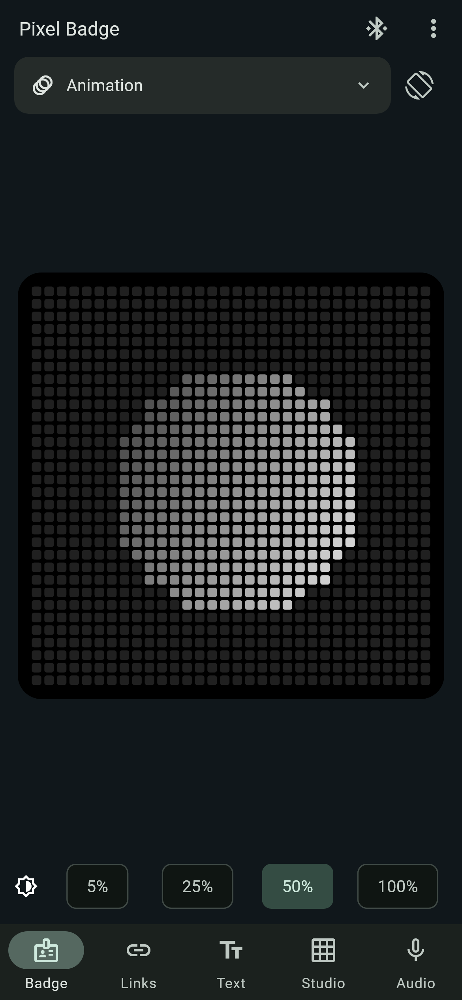
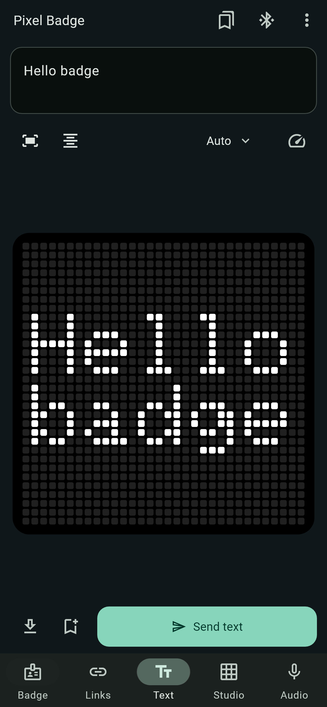
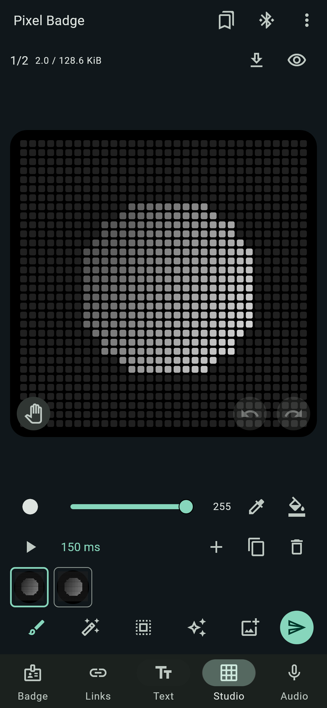

# Pixel Badge

**A wearable LED badge with BLE configuration and passive NFC.**

Pixel Badge displays contact links, text, and animations on a 32 × 32 LED matrix.
The project covers custom PCB design, embedded firmware, and an Android companion
app, developed first on an nRF5340 DK and then ported to an nRF52840 module.

<p align="center">
  
  <br>
  <em>Rev A PCB — KiCad CAD render.</em>
</p>

**Status · October 2026:** the DK prototype is running; Rev A boards are in
production. Custom-board bring-up, battery runtime, thermals, and RF validation
are pending. [Validation records](docs/validation.md).

## Features

- **Contact sharing:** QR display and a passive NFC tag with the same destination.
- **Display content:** text, drawings, and up to 128 frames of grayscale artwork.
- **Motion and audio:** automatic rotation, an IMU-driven particle fluid effect,
  and microphone level/spectrum visualization.
- **Phone control:** BLE configuration, artwork editing, and image/GIF/video import.
- **Recording:** an opt-in development build streams encrypted audio to the phone;
  audio is never stored on the badge.

## Hardware and firmware

| Area | Design |
|---|---|
| MCU | Ebyte E73 nRF52840 module; nRF5340 DK development fixture |
| PCB | 118 × 76 mm, four layers, designed in KiCad |
| Display | 1024 white LEDs, 2 mm pitch, constant-current column sinks and switched rows |
| Firmware | C++17 and C, Zephyr RTOS, nRF Connect SDK 3.4.1 |
| Power | USB-C, BQ25620 charger, protected 1S LiPo, separate logic and LED rails |
| App | Flutter with Android BLE, media, and encrypted recording support |

The matrix uses SPI/DMA and TIMER/PPI blanking, with an independent hardware
scan-stall circuit. Shared services use bounded buffers and queues; two artwork
banks preserve the previous content during an interrupted upload. BLE changes
require completion and readback, including QR/NFC agreement for link updates.

See the [system architecture](docs/architecture.md) and
[Rev A firmware design](docs/rev-a-firmware.md) for the implementation.

## Prototype

<p align="center">
  
  
</p>

The nRF5340 DK and external HUB75 panel provide an accessible fixture for
display, sensor, BLE, and NFC development. These photos show the RGB bench
panel; Rev A uses white LEDs on the custom PCB.

## Companion app

<p align="center">
  
  
  
</p>

Badge, Text, and Studio workspaces. UI review captures use test data.
The app also supports recording playback and explicit WAV export.
[App setup and behavior](app/README.md).

## Build and test

Install nRF Connect SDK **3.4.1** and its matching toolchain. From PowerShell:

```powershell
.\scripts\dev.ps1 build -Image Prototype -Pristine
.\scripts\dev.ps1 build -Image Main -Pristine
.\scripts\dev.ps1 test
.\scripts\dev.ps1 check
```

Windows host tests require Docker. See [firmware setup](docs/firmware.md#building)
for prerequisites, Linux commands, and the Diagnostics image. Main keeps matrix
output, recording, and charging disabled by default; follow the
[bring-up checklist](docs/bringup.md) before enabling hardware tests.

Tests cover portable services, interrupted writes, protocol bounds, display
health, and power policy, alongside Flutter/Kotlin app tests. The
[DK timing capture](validation/results/2026-10-09-dk-matrix-timing/README.md)
records a 195.2 Hz standalone scan; current grayscale and Rev A timing need
separate measurements.

## Explore the source

[Firmware and tests](firmware/README.md) · [KiCad and carrier files](hardware/README.md) ·
[Android app](app/README.md) · [Documentation](docs/README.md) ·
[Design decisions](docs/decisions/README.md)

## License

[MIT](LICENSE), with [third-party notices and Apache-2.0 board files](docs/firmware.md#licenses).
