# Pixel Badge

A wearable 32 × 32 LED badge that shows a QR code, text and animations, and
hands out a contact link over NFC. A phone app sets it up over Bluetooth.

I designed the PCB in KiCad, wrote the firmware on Zephyr, and built the
Android app in Flutter. The firmware started on an nRF5340 DK with a HUB75
panel and now runs on the custom nRF52840 board.

<p align="center">
  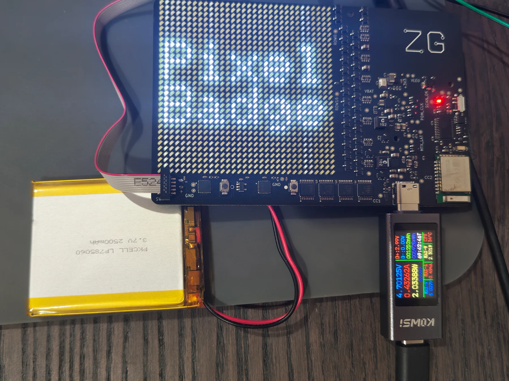
</p>

## Where it stands

Rev A boards are built and working (November 2026). Bring-up turned up an
assembly fault on the module, a scan that flickered, and a few USB and
charging quirks. All are fixed. Board 1 runs everything: display, BLE, NFC,
motion, audio and charging. It lasted 22 hours on the battery showing a QR
code at half brightness.

Bare LEDs make a QR code that phones struggle to read. A printed white diffuser
over the matrix fixes that, so the code scans easily. That's a first hands-on
result, not a formal scan test yet.

Still untested: NFC and BLE range, thermals, and System OFF on the battery.
[Bring-up record](validation/results/2026-11-03-rev-a-bringup/README.md),
[all test records](docs/validation.md).

<p align="center">
  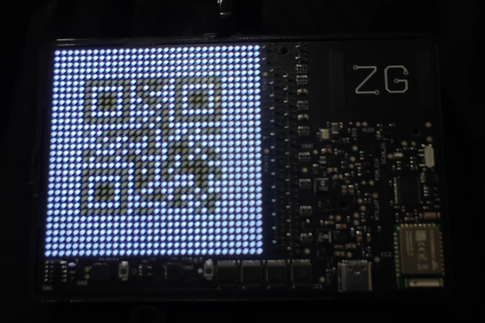
  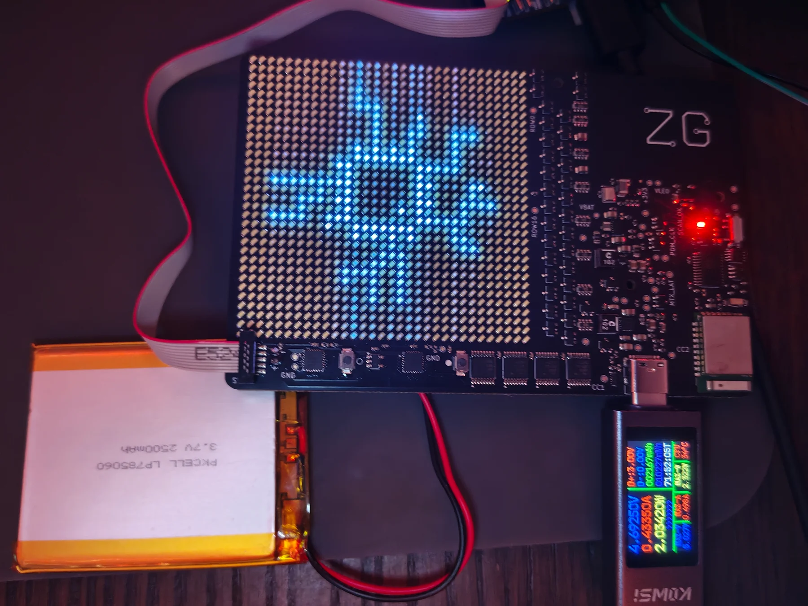
  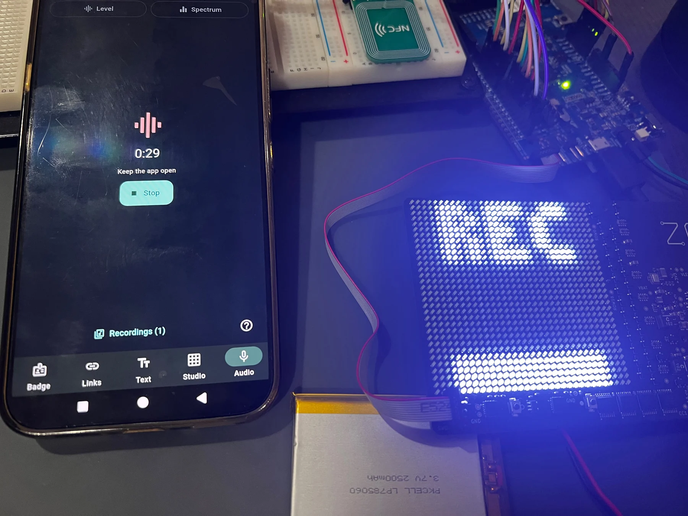
</p>

<p align="center">
  <a href="docs/images/rev-a-fluid.mp4">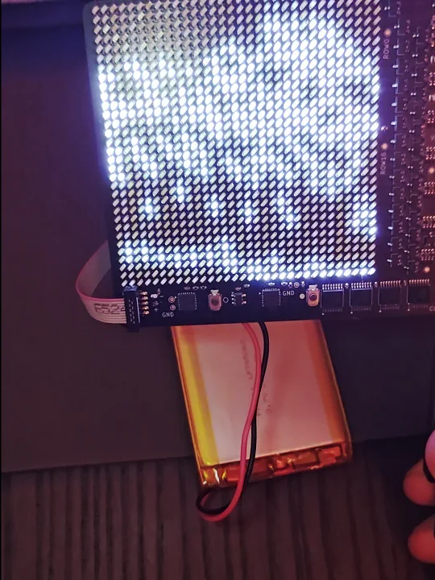</a>
  <br>
  <em>Tilt-driven particle fluid (click for video).</em>
</p>

## What it does

- Shows a contact QR code and serves the same link from a passive NFC tag.
- Displays text, drawings and grayscale animations of up to 128 frames.
- Rotates with the IMU and runs a particle fluid effect.
- Shows microphone level and spectrum. An opt-in bench build can stream
  encrypted audio to the phone, which stores it. Audio never touches the
  badge's flash.

## Inside

| | |
|---|---|
| MCU | Ebyte E73 module (nRF52840), BLE and app on one core |
| Display | 1024 white LEDs at 2 mm pitch, constant-current column drivers, hardware-timed scan |
| Board | 118 × 76 mm, four layers, all parts on the front |
| Power | USB-C, BQ25620 charger, protected 2500 mAh LiPo, separate LED rail |
| Sensors | ICM-42688-P IMU, PDM microphone, NT3H2111 NFC tag with a PCB coil |
| Firmware | C++17 and C on Zephyr, nRF Connect SDK 3.4.1 |
| App | Flutter, Android |

The CPU doesn't drive the LED scan. SPI DMA, timers and PPI do, and the CPU
takes one interrupt per brightness plane. If the firmware ever stops, a
hardware one-shot blanks the matrix within about a millisecond. Settings
changes over BLE are staged, applied one at a time and read back before the
app shows them as done. [How it fits together](docs/architecture.md).

## Carrier

<p align="center">
  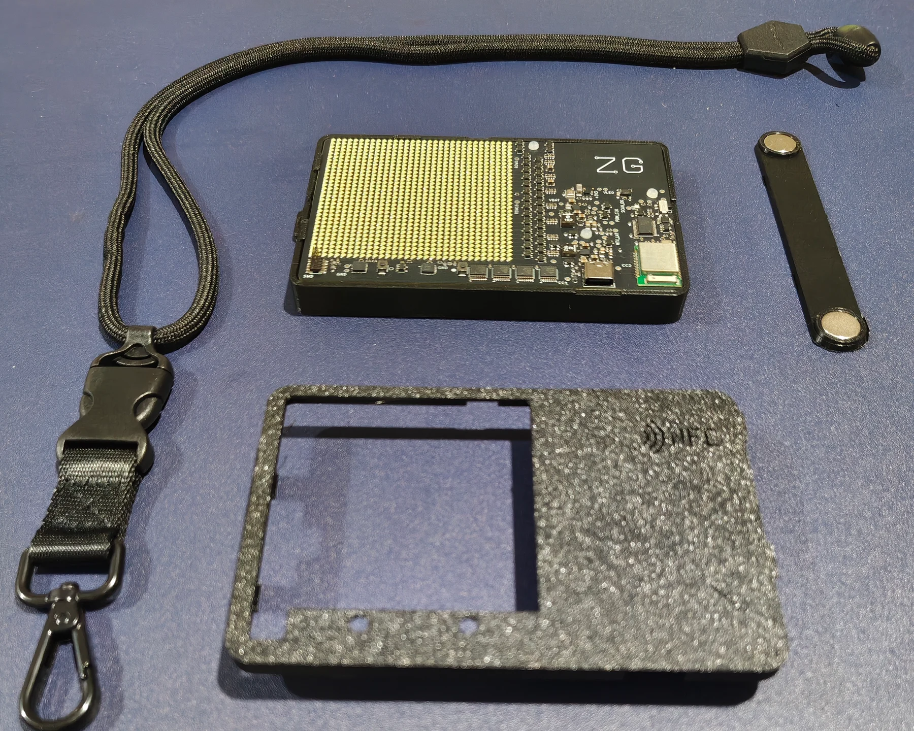
  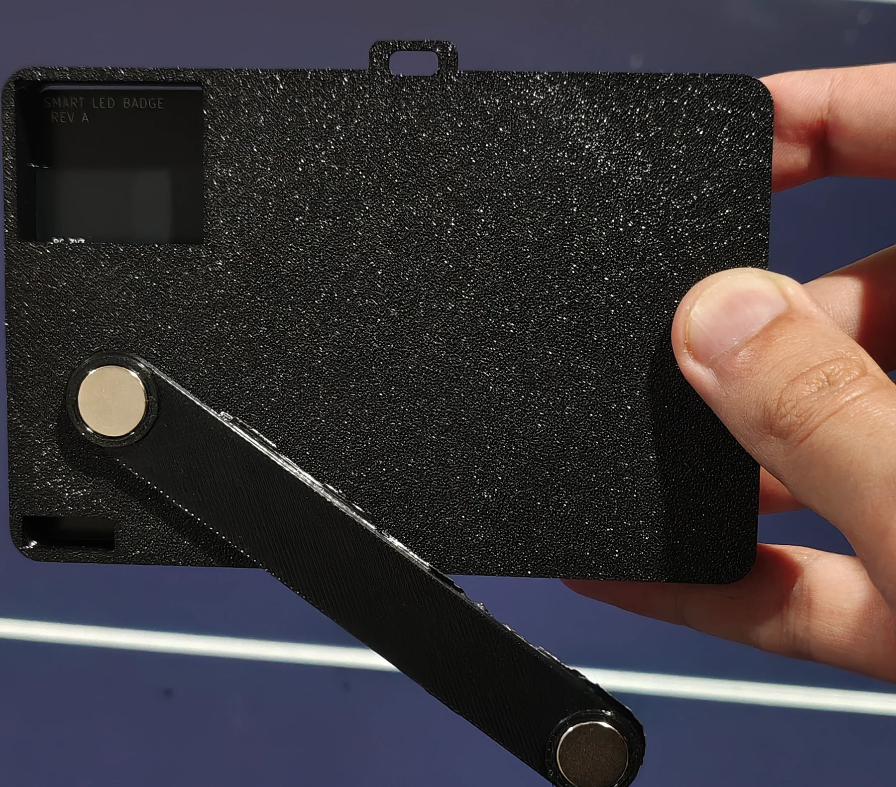
</p>

A 3D-printed carrier holds the board and battery. It clips on with a magnetic
backing or hangs from a lanyard, in portrait or landscape. Print files are in
[hardware/mechanical](hardware/mechanical/).

## Prototype

<p align="center">
  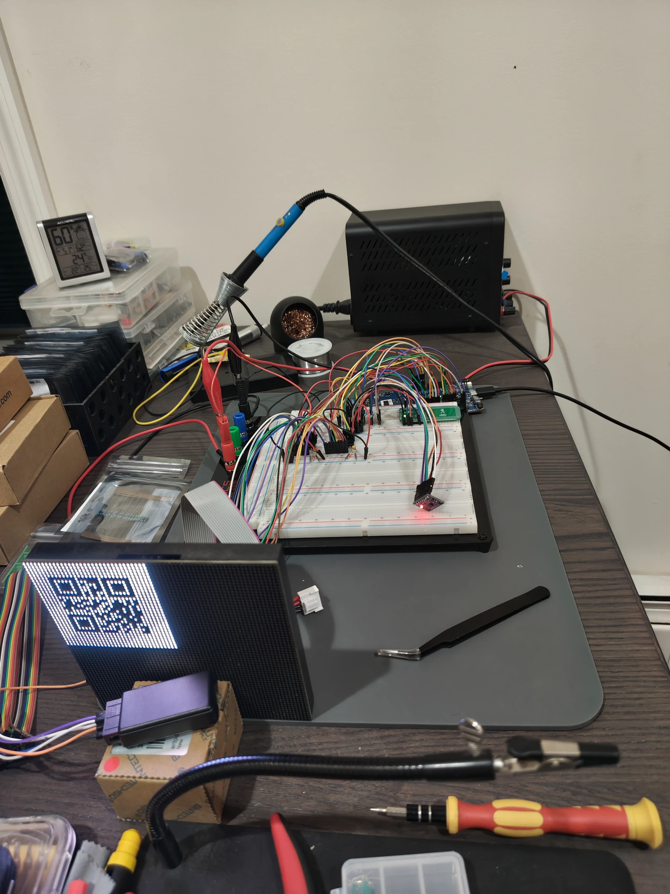
  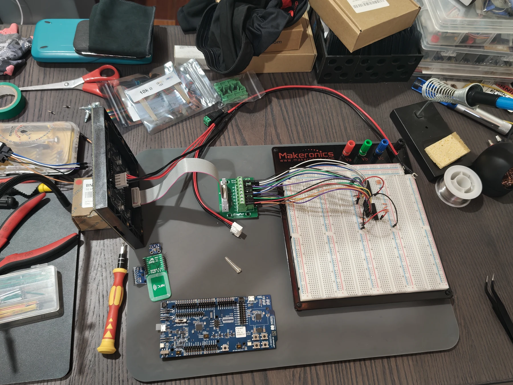
</p>

Before the boards existed, the firmware ran on an nRF5340 DK driving an RGB
HUB75 panel, with breakout boards for the tag, IMU and microphone. That bench
still builds and is useful for app work.

## App

<p align="center">
  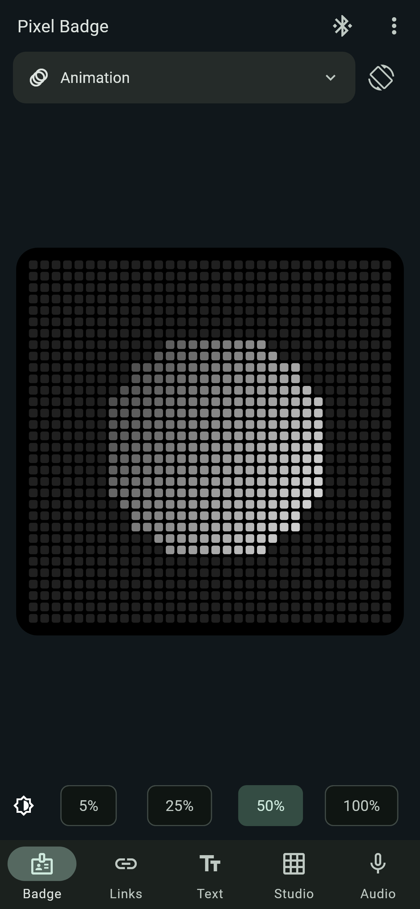
  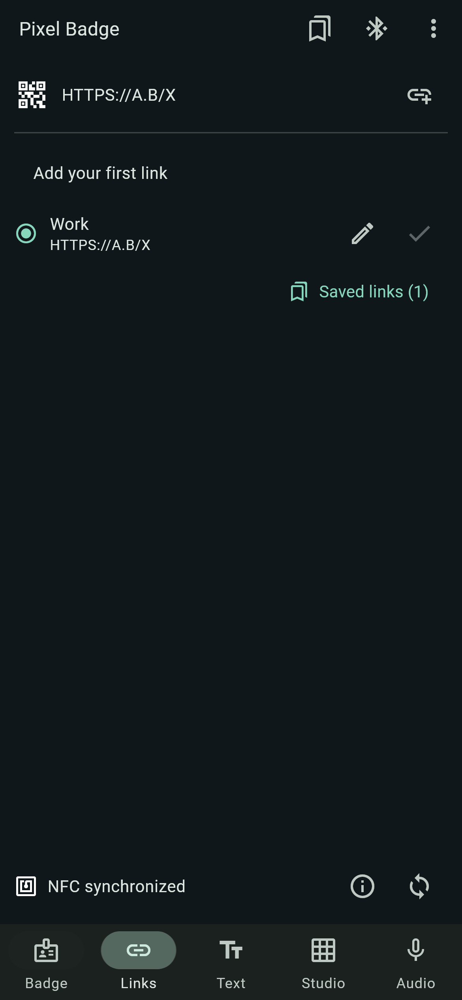
  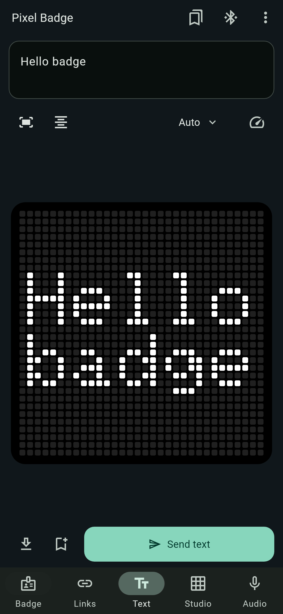
  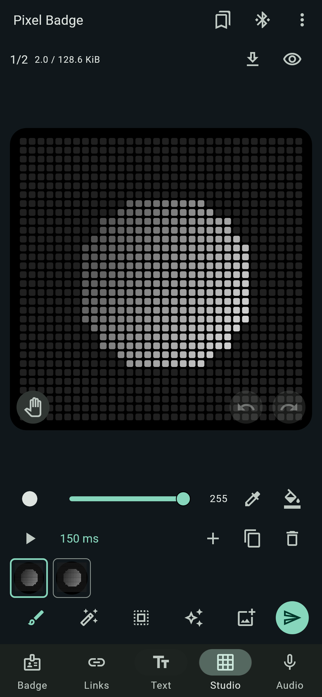
</p>

Badge, Links, Text and Studio pages (test data). [App README](app/README.md).

## Build

Install nRF Connect SDK 3.4.1 and its toolchain, then from PowerShell:

```powershell
.\scripts\dev.ps1 build -Image Main -Pristine
.\scripts\dev.ps1 build -Image Prototype -Pristine
.\scripts\dev.ps1 test     # host tests, needs Docker
.\scripts\dev.ps1 check
```

Main ships with the LED output, charging and recording turned off. Bench
add-ons turn them on deliberately. [Firmware guide](docs/firmware.md),
[bring-up checklist](docs/bringup.md).

## Repository

[firmware/](firmware/README.md), [hardware/](hardware/README.md),
[app/](app/README.md), [docs/](docs/README.md),
[design decisions](docs/decisions/README.md).

## License

[MIT](LICENSE), with some [third-party notices and Apache-2.0 board files](docs/firmware.md#licenses).
