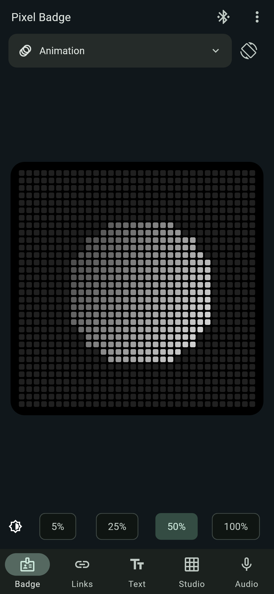
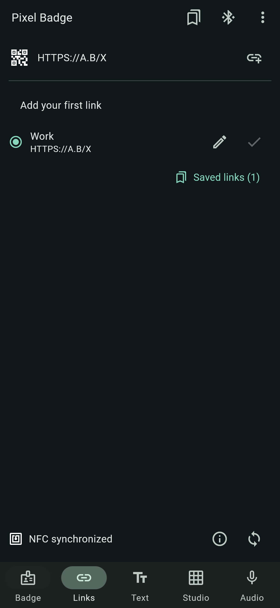
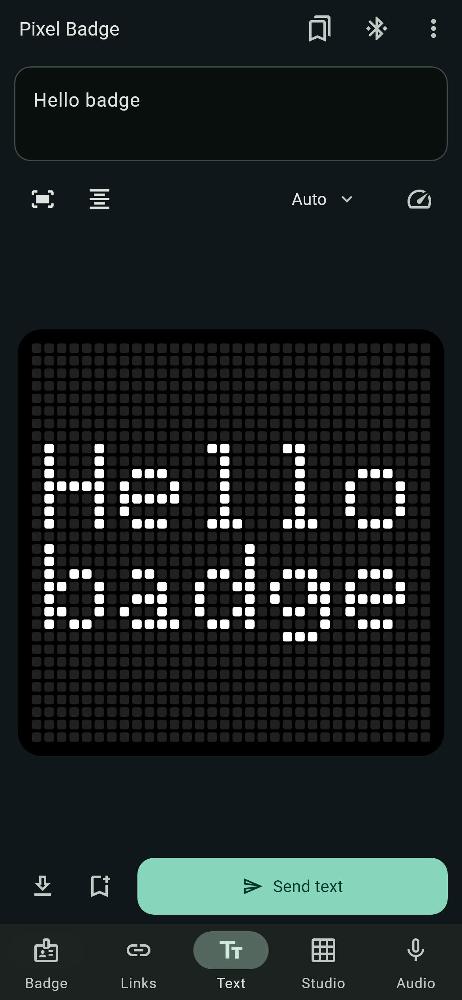
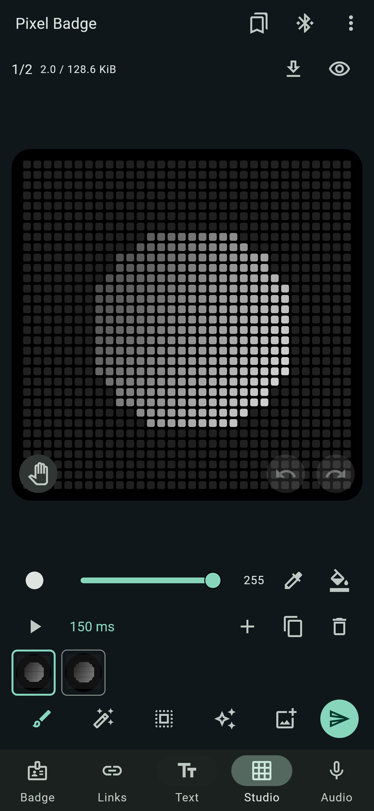

# Pixel Badge app

The Flutter companion app, Android first. It sets up the display, shares a
contact link through the QR code and NFC tag, edits artwork, and keeps
recordings. It speaks [BLE protocol v2](../docs/ble-protocol.md) and still
handles older badges. iOS isn't packaged.

<p align="center">
  
  
  
  
</p>

| Page | What it does |
|---|---|
| Badge | Connect, brightness, mode, rotation and motion settings. The app bar shows the battery level; tap it for details |
| Links | Saved short links; apply one to the QR code and tag and check they agree |
| Text | Write, preview, align, scroll or bounce lines; drafts are saved |
| Studio | Draw on a 32 × 32 grayscale canvas, animate, import images, GIFs and video |
| Audio | Level and spectrum modes, record, play, delete, export WAV |

Drafts save on the phone and stay separate from what's on the badge. Current
firmware takes up to 128 frames. Video import samples up to 128 frames from a
clip of up to 64 seconds. Image conversion runs off the UI thread.

The editor took ideas from the public docs of
[GlyphMatrixEditor](https://github.com/pauwma/GlyphMatrixEditor) and
[Glyph Museum](https://app.glyphmuseum.com/editor?remix=6748). None of their
code or assets is included.

## Connecting

Hold the badge's Action button, then type the code it shows into the phone's
pairing dialog. The app waits until a change has completed and read back
before it shows it as applied. After an interrupted upload, Refresh and try
again; nothing is replayed on its own. The first connection after a scan is
retried once, because Android often fails it.

A foreground service keeps the link alive across screens. Disconnect, a
force-stop or radio loss ends it.

Recording only works with firmware built for it. It stops when the app leaves
the foreground, the link drops, or the badge can't show its recording view.
Recordings are encrypted with keys wrapped by Android Keystore and kept out
of backups. [Audio](../docs/audio-prototype.md).

## Development

Flutter 3.38.5, Android SDK 36, Build Tools 36.1.0, and NDK 28.2.13676358 (app)
and 27.0.12077973 (plugins). Dependencies are pinned in `pubspec.lock`.

```powershell
Push-Location app; flutter pub get; Pop-Location
.\scripts\app\dev.ps1 check
.\scripts\app\dev.ps1 test
.\scripts\app\dev.ps1 build
adb install -r app/build/app/outputs/flutter-apk/app-debug.apk
```

Always build the APK through `scripts/app/dev.ps1 build`. It reads the four
public `BADGE_URL_*` presets from an optional root `.env`
([example](../.env.example)); without them, presets are off and you type links
by hand. Keep links short enough for the QR code.

CI also runs the Android unit tests for storage, crypto, connection and
playback. To run Gradle directly on a fresh checkout, first run
`flutter build apk --debug --config-only` in `app/`.
