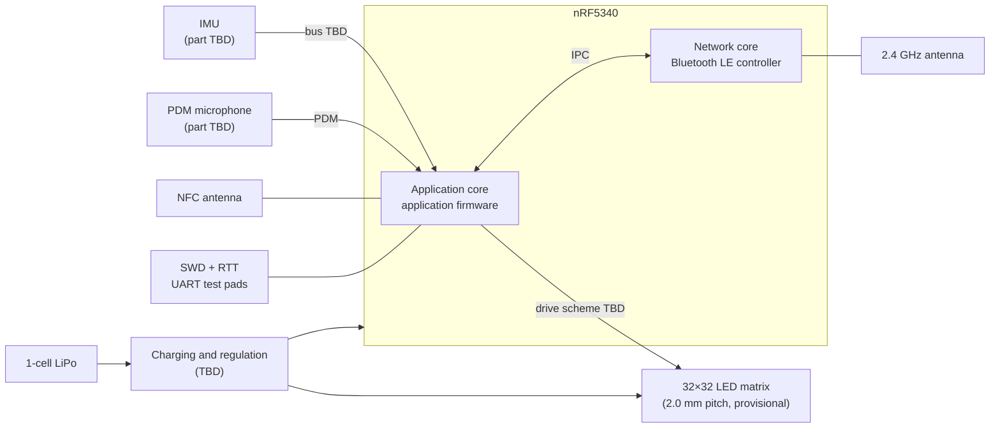

# System architecture

Status: **provisional**. Items marked TBD are open decisions. Nothing in this
document has been validated on hardware yet; see [validation.md](validation.md).

## Overview

The badge is a battery-powered wearable built around a Nordic nRF5340. It
drives a 32×32 monochrome LED matrix and uses BLE, NFC, an IMU, and a PDM
microphone as inputs to a set of display modes (QR link, name/identity,
motion-driven and audio-driven visualizations, project statistics).

Development starts on the nRF5340 DK. The final PCB will use an nRF5340 radio
module (exact module TBD).

## Subsystems

| Subsystem | Direction | Status |
|---|---|---|
| MCU | nRF5340 (DK for development, module on final PCB) | Module TBD |
| Display | 32×32 monochrome white LEDs, 2.0 mm pitch | Pitch pending QR prototype validation |
| Matrix drive | Custom driver, refresh driven by hardware peripherals/DMA rather than CPU bit-banging | Circuit and peripheral allocation TBD |
| Wireless | BLE, NFC | Services and data model TBD |
| Sensors | IMU, PDM microphone | Parts and interfaces TBD |
| Power | 1-cell LiPo | Charger, regulators, and protection TBD |
| Debug | SWD, SEGGER RTT logging; UART test pads on custom board | Required on Rev A |
| Mounting | Magnetic wearable mount | Mechanical design TBD |

## Engineering priorities

In order: QR scan reliability, PCB electrical correctness, matrix timing and
brightness, firmware reliability, battery/power behavior, BLE/NFC usability,
mechanical wearability, visual polish.

## Open decisions

- Final nRF5340 module.
- LED matrix pitch (2.0 mm provisional), LED part, and drive circuit.
- IMU and microphone parts.
- Power architecture.
- BLE and NFC service design.
- PCB stack-up (4-layer provisional).

Accepted decisions are recorded as ADRs in [decisions/](decisions/README.md).

See also: [firmware.md](firmware.md), [hardware.md](hardware.md).
