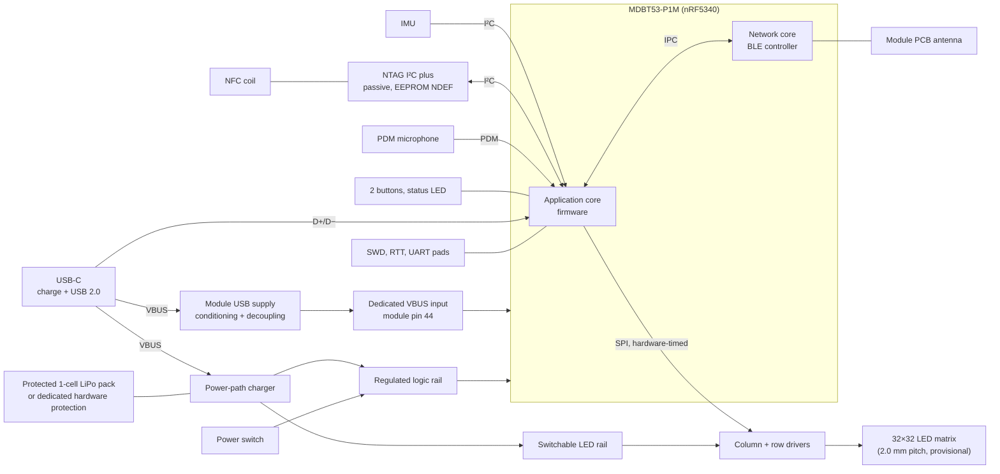

# System architecture

Status: **Rev A architecture defined; nothing validated on hardware yet.**
Items marked provisional or TBD may change; see [validation.md](validation.md)
for how they will be tested.

## Overview

The badge is a battery-powered wearable identity/networking badge built around a
Nordic nRF5340 radio module. It drives a 32×32 monochrome white LED matrix and
offers these Rev A modes and functions:

- QR link display and name/identity display
- Motion-driven Flip/fluid-style simulation (IMU input)
- Audio visualization (PDM microphone, processed locally)
- BLE configuration from a companion phone app; the badge works without a phone
  once configured
- A passive NFC tag that opens the same link as the QR code, including when the
  badge is switched off or the battery is empty

Development uses the nRF5340 DK; the badge uses a Raytac MDBT53-P1M module.

## Subsystems

| Subsystem | Rev A design | Status |
|---|---|---|
| MCU | Raytac MDBT53-P1M (nRF5340), external 32.768 kHz crystal | Selected |
| Display | 32×32 white SMD LEDs, binary pixels, discrete global brightness levels | Pitch 2.0 mm and 1:32 multiplexing provisional pending prototype testing |
| Matrix drive | Constant-current column sinks, high-side row switches, refresh timed by hardware peripherals; matrix forced off if the scan stalls | Parts provisional |
| BLE | Module antenna at a board edge/corner; configuration via companion app | Selected |
| NFC | External passive NFC tag (NTAG I²C plus family) with PCB coil; MCU updates contents over I²C when powered | Architecture selected; exact part provisional |
| Sensors | 6-axis IMU (I²C, interrupts); PDM microphone | Parts provisional |
| Power | Independently protected 1-cell LiPo; USB-C charging with power path, charging works with the switch off; dedicated module USB VBUS supply; regulated logic rail; LED rail switchable by firmware; matrix load shed on low battery | Protection required; specific parts provisional |
| User interface | Two buttons (Mode/Next, Action/Select), physical power switch, one status LED | Selected |
| Debug | SWD, SEGGER RTT logging, UART test pads, rail and matrix-timing test points | Required on Rev A |
| Mechanics | 4-layer PCB ≤ 112 × 74 mm (108 × 72 mm nominal), black soldermask, LEDs on the front, rear 3D-printed carrier with battery and magnetic attachment | Outline provisional within the maximum |

## Engineering priorities

In order: QR scan reliability, PCB electrical correctness, matrix timing and
brightness, firmware reliability, battery/power behavior, BLE/NFC usability,
mechanical wearability, visual polish.

## USB and battery requirements

USB-C VBUS supplies **both** the charger input and the module's dedicated VBUS
input (pin 44). D+ and D− connect to module pins 46 and 48. USB also requires
the normal device supply; VBUS does not replace the regulated logic rail.
Connection, decoupling, conditioning, and off-state review are specified in
[power.md](power.md), using the Nordic USBREG specification and Raytac Ver.E
§§2.5 and 8.1.2.

Use a commercially protected 1-cell LiPo pack for Rev A. An unprotected cell
requires a dedicated hardware protection circuit instead. Charger/power-path
functions and firmware load shedding do not replace independent battery
overdischarge, overcurrent, and short-circuit protection. Pack selection and
protection ratings remain open; no safety or runtime measurements exist.

## Open decisions

- LED matrix pitch, LED part, and drive current (after QR testing).
- Exact board outline within the size limit.
- Battery cell.
- Exact NFC tag, IMU, and microphone parts.

The owner-selected Rev A architecture is recorded in
[decisions/](decisions/README.md). Those ADRs remain `Proposed` while this pull
request awaits approval and merge, per the repository's ADR process. Design
selection does not establish hardware validation.

See also: [firmware.md](firmware.md), [hardware.md](hardware.md),
[power.md](power.md).
