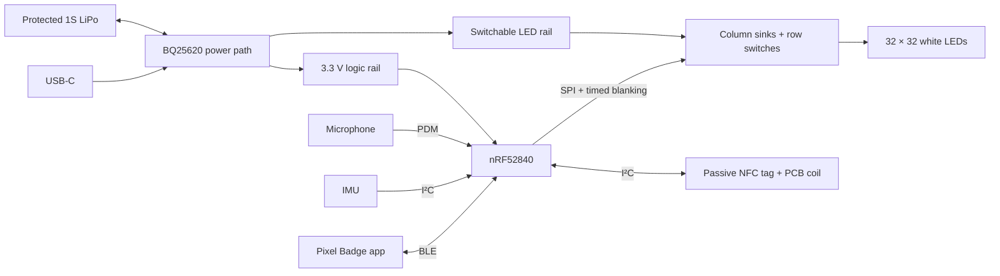

# Architecture

## Display

Two TLC59283 drivers sink constant current on the 32 columns. Four 74HC595
shift registers and 32 P-channel FETs select the row. The nRF52840 runs the
scan in hardware: SPI DMA shifts each row, timers and PPI time the latch and
blanking, and the CPU takes one interrupt per brightness plane. If latching
stops for any reason, a one-shot blanks the matrix on its own.

## Firmware

Prototype (nRF5340 DK) and Rev A (nRF52840) share all application code and
storage formats. Each has its own board files and display driver. The app
layer picks modes, portable services handle content, protocols and storage,
and drivers own the hardware. Buffers are fixed-size and statically allocated.

## Settings over BLE

Writes need an authenticated, bonded phone. Each change is staged first, then
applied with an explicit Apply. The app waits for completion and reads the
value back before showing it as done. A link change also writes the NFC tag,
and only succeeds once the QR code and the tag agree.

## NFC

An NT3H2111 tag stores the public link. Phones can read it with the badge
off. RF writes are password protected, while the MCU updates it over I²C.
[NFC design](nfc.md).

## Power

The BQ25620 charger runs the system from USB or the battery. Separate
regulators feed the logic and the LEDs. Firmware reads the battery through a
switched divider, caps brightness when it gets low, and turns the LED rail off
before the pack's protection would trip. With USB in and the switch off, the
badge just charges. [Power design](power.md).

## Recovery and updates

A watchdog and display health checks recover from stuck services. MCUboot
and two image slots leave room for updates later, but there's no OTA
transport yet. Programming and logs go over SWD and RTT.

The module moved from nRF5340 to nRF52840 because the nRF5340 module wasn't
available for assembly. That put the app and the radio on one core.
[Trade-offs](rev-a-firmware.md#nrf5340-to-nrf52840).
