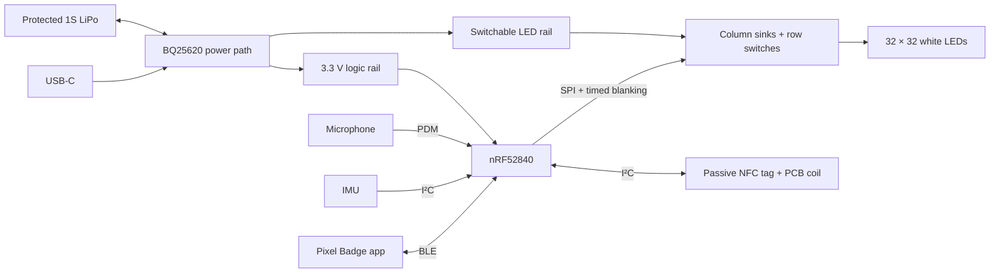

# System overview

Pixel Badge combines a multiplexed LED display, BLE configuration, and a passive
NFC contact link. The nRF5340 DK prototype and nRF52840 Rev A application share
services and storage formats, with separate board definitions and display drivers.
Rev A is in production; its electrical and physical performance awaits bring-up.

## Main design choices

- **Display:** two TLC59283 column sinks, four HC595 row registers, a level
  translator, and 32 high-side PFETs. TIMER/PPI limits each light pulse; an
  independent monostable forces blanking if latching stops.
- **Shared firmware:** application code selects modes; portable services handle
  content, protocols, storage, and policies. Board drivers own GPIO and timing.
  Application buffers are bounded and statically allocated.
- **Configuration:** authenticated BLE writes stage changes, then an explicit
  Apply commits them. The app checks completion and exact readback. URL changes
  also verify the NFC EEPROM so the QR and NFC destinations agree.
- **Passive NFC:** an external NTAG I²C plus stores the public URL. RF reads
  remain public; provisioning protects RF writes while allowing MCU updates.
- **Power:** the BQ25620 manages USB/battery power; separate regulators supply
  logic and LEDs. Switched battery sensing drives brightness limiting and load
  shedding. USB with the switch off runs a charging-only firmware state.
- **Recovery:** watchdog and display-health checks handle stalled services;
  MCUboot and two image slots preserve room for a future update transport.
  SWD/RTT provide programming and logs. OTA updates are not implemented.

The module changed from nRF5340 to nRF52840 because of assembly availability.
The port puts the application and radio controller on one core and replaces
the DK display backend. [Trade-offs and resource map](rev-a-firmware.md).

## Validation boundaries

DK measurements establish prototype behavior for the recorded setup. They do
not establish Rev A refresh, brightness, battery runtime, or RF performance.
Recording remains an explicit development option pending visibility, security,
and endurance checks. Charging and load-shed thresholds require measurements on
the assembled board.

See [hardware](hardware.md), [firmware](firmware.md), [power](power.md),
[NFC](nfc.md), and [validation](validation.md). The
[decision records](decisions/README.md) explain the design history.
