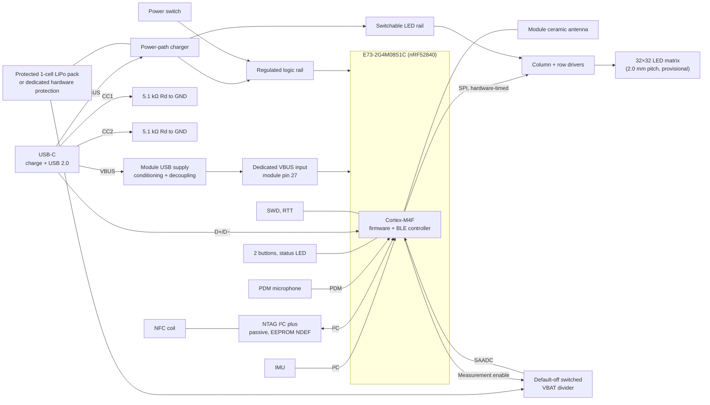

# System architecture

Status: **Rev A architecture defined; nothing validated on hardware yet.**
Items marked provisional or TBD may change; see [validation.md](validation.md)
for how they will be tested.

## Overview

The badge is a battery-powered wearable identity/networking badge built around a
Nordic nRF52840 radio module. It drives a 32×32 monochrome white LED matrix and
offers these Rev A modes and functions:

- QR link display and name/identity display
- Motion-driven Flip/fluid-style simulation (IMU input)
- Audio visualization (PDM microphone, processed locally) and visible voice
  recording streamed to the phone app ([ADR 0011](decisions/0011-visible-voice-recording.md))
- BLE configuration from a companion phone app; the badge works without a phone
  once configured
- A passive NFC tag that opens the same link as the QR code, including when the
  badge is switched off or the battery is empty

The prototype firmware runs on the nRF5340 DK; the badge uses an Ebyte
E73-2G4M08S1C module (nRF52840, [ADR 0015](decisions/0015-nrf52840-e73-module.md)),
and the Rev A firmware port to it is pending.

## Subsystems

| Subsystem | Rev A design | Status |
|---|---|---|
| MCU | Ebyte E73-2G4M08S1C (nRF52840, ceramic antenna), external 32.768 kHz crystal with 12 pF loads | Selected; firmware port pending |
| Display | 32×32 white SMD LEDs, binary pixels, discrete global brightness levels | Pitch 2.0 mm and 1:32 multiplexing provisional pending prototype testing |
| Matrix drive | 2 × TLC59283 constant-current column sinks; SN74HC595 row registers behind an SN74LVC8T245 translator driving AO3401A high-side row switches; refresh timed by hardware peripherals; a retriggerable monostable, inverter and OR gate force blanking and turn the rows off if the scan stalls | Parts selected and drawn; 18.0 mA nominal column setting (about 19.4 mA worst case); peak current prototype-dependent |
| BLE | Module antenna at a board edge/corner; configuration via companion app | Selected |
| NFC | External passive NFC tag (NXP NT3H2111W0FHKH, XQFN-8) with PCB coil on its own switched I²C bus; public RF reads, protected RF writes, MCU I²C updates | Part selected; coil tuning and provisioning bytes provisional |
| Sensors | TDK ICM-42688-P 6-axis IMU on I²C with interrupts (project I²C driver; no SPI fallback on Rev A); Knowles SPH0641LM4H-1 PDM microphone | IMU conditional on real-part verification; microphone conditional on lifecycle check |
| Power | Protected 1-cell LiPo pack (Adafruit 328, 2500 mAh); BQ25620 switching USB-C charger with NVDC power path (≈ 1 A charge, BC1.2 detection) and separate CC1/CC2 Rd; dedicated module USB VBUS supply; TPS63802 3.3 V logic rail powered by the switch or by USB (charging-only mode); switched VBAT-to-SAADC sensing; TPS61023 firmware-switchable LED rail with low-battery load shedding | Parts selected; charging works with switch off; thresholds and VLED provisional |
| User interface | Two buttons (Mode/Next, Action/Select), physical power switch, one status LED; worn landscape or portrait with firmware-rotated content | Selected |
| Debug | SWD, SEGGER RTT logging, rail and matrix-timing test points (no UART or spare GPIO pads: the module has no free GPIO) | Required on Rev A |
| Mechanics | 4-layer PCB, Rev A outline 118 × 76 mm (the maximum; 108 × 72 mm nominal), black soldermask, single-sided assembly with all components on the front ([ADR 0010](decisions/0010-single-sided-assembly.md)), rear 3D-printed carrier with the battery, magnetic attachment and lanyard attachment points | Outline provisional within the maximum |

## Engineering priorities

In order: QR scan reliability, PCB electrical correctness, matrix timing and
brightness, firmware reliability, battery/power behavior, BLE/NFC usability,
mechanical wearability, visual polish.

## USB and battery requirements

Terminate CC1 and CC2 separately to ground with two 5.1 kΩ, 1% Rd resistors,
present even when switched off or without a battery. Do not join the CC pins.
This provides sink attachment in either orientation without USB PD.

USB-C VBUS supplies **both** the charger input and the module's dedicated VBUS
input (pin 27). D+ and D− connect to module pins 31 and 29. USB also requires
the normal device supply; VBUS does not replace the regulated logic rail.
Connection, decoupling, conditioning, and off-state review are specified in
[power.md](power.md); its module-level values were derived for the MDBT53
and are reviewed for the E73 (nRF52840) at bring-up.

Rev A uses a commercially protected 1-cell LiPo pack (Adafruit 328, 2500 mAh).
Charger/power-path functions and firmware load shedding do not replace its
independent overdischarge, overcurrent and short-circuit protection. The cell
allows up to 1.2 A charge (vendor) and 1.5 A continuous discharge; the pack
has no thermistor, so a board NTC at the edge over the pack qualifies charging. No safety or
runtime measurements exist. See [power.md](power.md#independent-battery-protection).

The power switch is a signal-level control: with USB attached the logic rail
runs a charging-only firmware state even when the switch is OFF. See
[power.md](power.md#power-states).

Measure the protected pack's VBAT output through a default-off switched divider
to an nRF52840 SAADC input. The regulated logic voltage is not battery state.
Rev A uses voltage-based load shedding; divider values, acquisition timing,
error margin, shed/recovery thresholds and discharge characterization remain
provisional. See [power.md](power.md#battery-state-measurement).

## Display orientation

The badge is worn landscape or portrait, on a magnet mount or a lanyard
([ADR 0009](decisions/0009-dual-orientation-dual-mounting.md)). The square
display lets firmware rotate the name, animation and QR views in 90° steps
from the IMU's gravity vector, with hysteresis and a settling time so the
image does not flip on small movements; when the reading is ambiguous (for
example lying flat) the last orientation is kept. QR mode takes the
orientation once on entry and keeps it until the mode is left, so a scan is
never interrupted by a rotation.

## NFC content protection

The contact URL is public, including with all badge power removed. Provision
the tag to reject unauthenticated RF writes while retaining MCU/I²C EEPROM
updates. Factory-default NTAG protection is insufficient. The intended policy,
part-specific provisioning gate and recovery requirements are in
[nfc.md](nfc.md); tests cover powered and passive reads, rejected RF writes,
and subsequent authorized MCU updates.

## Open decisions

- LED matrix pitch, LED part, and drive current (after QR testing).
- Board outline details: the layout uses 118 × 76 mm, 3 mm corners and three
  M2 carrier holes; final at the PCB release.
- NFC coil tuning and provisioning bytes (verified on a development tag; see
  [nfc.md](nfc.md)).
- IMU: ICM-42688-P on I²C until real-part verification; Rev A has no SPI
  fallback ([ADR 0015](decisions/0015-nrf52840-e73-module.md)).
- Microphone lifecycle confirmation.
- Final button placement (front strip or the edge below the field) at outline
  freeze ([ADR 0008](decisions/0008-landscape-front-buttons.md)).
- Carrier, magnet and lanyard geometry for portrait and landscape wear
  ([ADR 0009](decisions/0009-dual-orientation-dual-mounting.md)); holding
  force and comfort need prototype validation.
- Charging temperature qualification with a pack that has no thermistor.

The owner-selected Rev A architecture is recorded in
[decisions/](decisions/README.md) as Accepted ADRs. Design selection does not
establish hardware validation.

See also: [firmware.md](firmware.md), [hardware.md](hardware.md),
[power.md](power.md).
