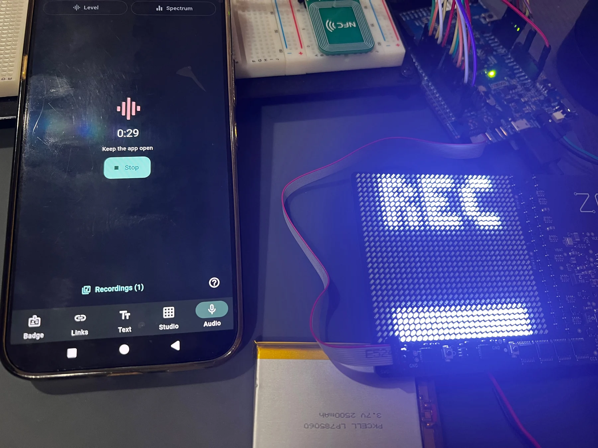

# Audio

Level and Spectrum modes run on the badge's microphone input. Recording is
off in normal builds; a bench build streams encrypted audio to the phone.

<p align="center">
  
</p>

## How it works

Rev A captures at 16 kHz. The DK captures at 32 kHz and decimates. Level mode
shows DC-removed RMS and Spectrum a 256-point FFT. Neither is a calibrated
sound level. Recording sends 10 ms IMA ADPCM blocks after a rumble filter,
automatic gain and a peak limiter.

Recording needs a bonded, authenticated phone with the app subscribed, and
the badge must be showing its recording view: REC across the top and a level
bar below, lit even in silence. Audio stays in RAM on the badge. The phone
keeps encrypted files outside backups and only writes WAV when you export.

## Build

Rev A: add `configs/recording-bench.conf` (and `matrix-bench.conf` so the
view can show) to a Main build. On the DK:

```powershell
.\scripts\dev.ps1 build -Image Prototype -BuildDir build/prototype-recording -ExtraConfFile firmware/nrf5340_prototype/configs/audio-recording-bench.conf -Pristine
.\scripts\dev.ps1 flash -Image Prototype -BuildDir build/prototype-recording
.\scripts\app\dev.ps1 build
adb install -r app/build/app/outputs/flutter-apk/app-debug.apk
```

## Checks

| Check | Expected |
|---|---|
| Level or Spectrum, then QR | Meters follow sound; the mic stops in QR |
| Reconnect the bonded phone | Audio is ready with no extra steps |
| Record 5–10 s, stop, play, seek, export | Complete, right speed, a usable WAV |
| Hold Mode with the app ready | A recording starts; either button stops it |
| The same on a normal build | Refused |
| Home, lock, unsubscribe, link loss | Stops, and never resumes on its own |
| Record past five minutes | No cap, gaps or resets |
| Look at the view in sun, shade and indoors | Clearly recording in all three |

Never let audio or keys into RTT logs or dumps. Failure cases are in the
[audio test plan](testing/sensors-audio.md#microphone-and-audio).
[Wire format](audio-protocol.md),
[software record](../validation/results/2026-10-14-p3-audio-start/README.md).
