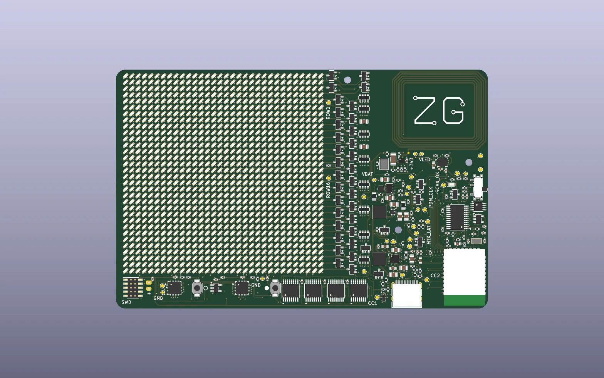
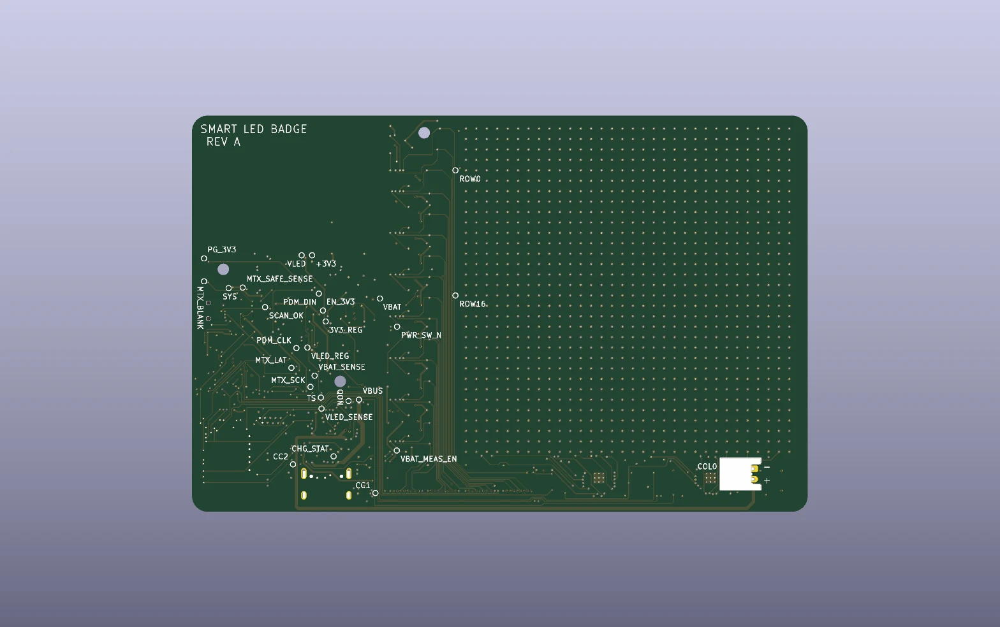
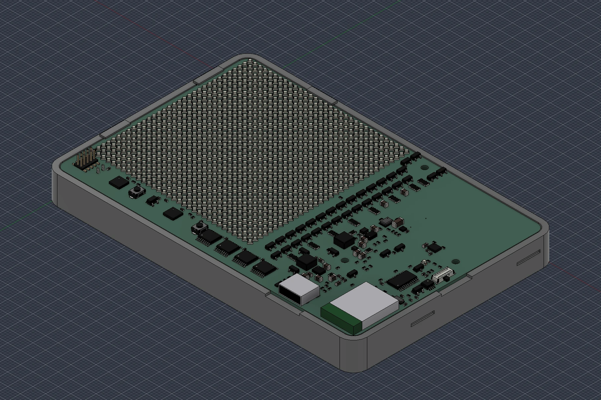
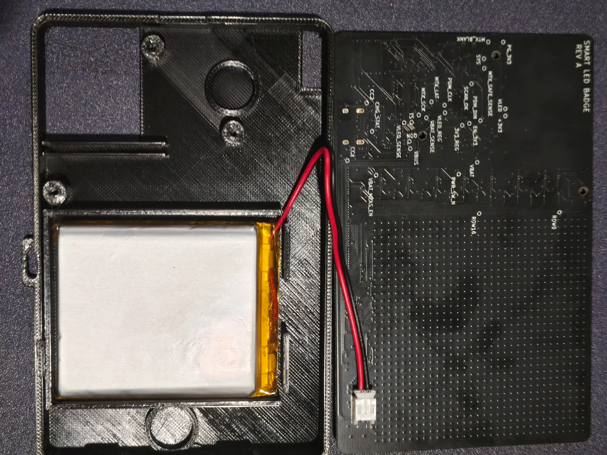

# Hardware

Rev A is a 118 × 76 mm, four-layer board designed in KiCad 10.0.6. Every
assembled part is on the front. The battery and its connector sit on the
back, inside the carrier. To open the project and run its checks, see the
[hardware source guide](../hardware/README.md).

  
  

## Parts

| Function | Part |
|---|---|
| MCU | Ebyte E73-2G4M08S1C (nRF52840) with ceramic antenna |
| Matrix | 1024 KT-0603W white LEDs, 2 mm pitch, 1/32 scan |
| Column drivers | 2 × TLC59283, 2.94 kΩ IREF (18 mA nominal) |
| Row select | 4 × SN74HC595, SN74LVC8T245, 32 × AO3401A |
| Scan-stall blanking | SN74LVC1G123 one-shot, inverter, OR gate |
| NFC | NT3H2111 with a 30 × 25 mm PCB coil |
| IMU | ICM-42688-P on I²C |
| Microphone | SPH0641LM4H-1, bottom port through the PCB |
| Charger | BQ25620 with power path |
| Regulators | TPS63802 (3.3 V logic), TPS61023 (switchable LED rail) |
| Battery | Protected 1S LiPo, 2500 mAh (PKCELL LP785060 on board 1) |
| Controls | USB-C, two buttons, slide switch, status LED, 10-pin SWD header |

All 29 module GPIO are in use, so there's no UART. Program and log over SWD
and RTT. Footprint sources are in the [library notes](../hardware/libraries/README.md),
datasheets in [references](references.md).

## Display safety

Column current is 18.0 mA nominal, up to about 19.4 mA with tolerances. SPI
shifts the row and column data, and blanking covers every row change. If the
latch pulses stop, the one-shot blanks the LEDs. It's calculated at
0.76–1.41 ms and measured 969–974 µs on board 2.

Only QR Version 1 fits the 32 × 32 matrix with a full quiet zone, at one LED
per module.

## Power

USB-C is a plain 5 V sink with separate 5.1 kΩ resistors on CC1 and CC2. VBUS
feeds both the charger and the module's USB supply. The slide switch is a
logic input; with USB in and the switch off, the badge only charges. The
board NTC measures board temperature, not the cell. Details and limits are in
[power](power.md).

## Carrier

  
  

The printed carrier holds the board and battery, with insulation between the
pack and the PCB. It takes a magnetic backing or a lanyard, in portrait or
landscape. The front holds a pixel grid and a white diffuser over the matrix;
the diffuser is what makes the QR code readable for phones. Print files are in
`hardware/mechanical/`. Fit, latch retention and long-term wear still need
checking on prints.

The [decision records](decisions/README.md) cover the module change,
single-sided assembly and board outline.
