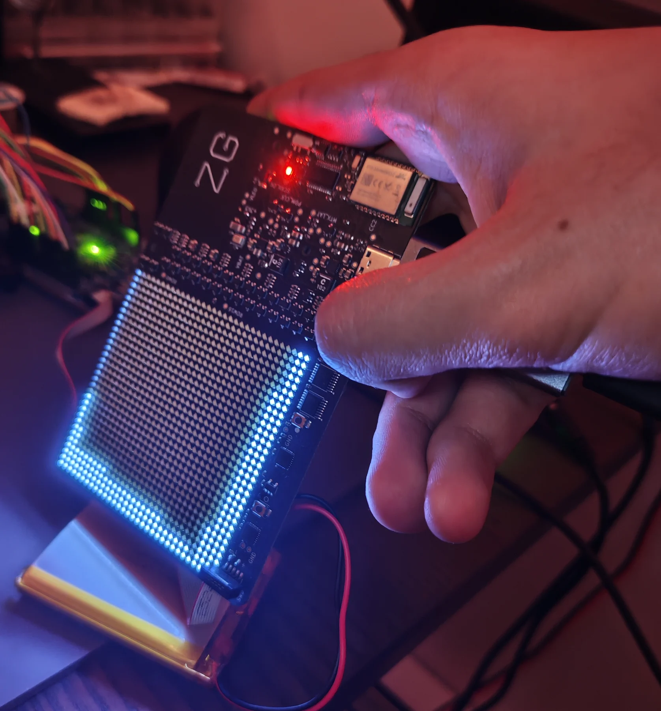
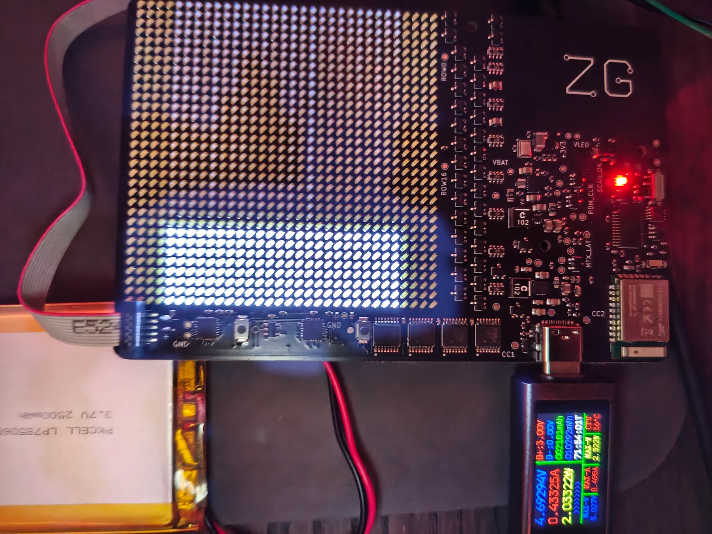

# Motion and fluid

The IMU turns the display in quarter steps and drives a particle fluid. The
fluid is fixed-point particles on the 32 × 32 grid with bounded collision
work and no allocation. It's a visual effect, not a physics solver.

  
  

On Rev A, particles used to stay piled on the edge they'd settled against
after a tilt (left). Now a blocked particle steps one cell sideways, so the
pile levels out (right).

## How it works

- 16–192 particles, 20 ms steps, at most four catch-up steps.
- A sensor worker handles data-ready events, up to 50 reads a second, and
  polls every 40 ms as a fallback. Interrupts only signal it.
- Auto-rotation filters, adds hysteresis and waits 250 ms before turning. QR
  locks its orientation on entry; text, artwork and audio follow rotation.
- Samples older than 250 ms freeze the fluid and show `IMU`.

The app sets rotation, response and particle count. On Rev A the IMU is
soldered down, so the firmware fixes its axes (+X right, −Y down) and ignores
the axes in the stored setting. On the DK, mount the loose IMU to match the
configured axes.

## Try it

1. Refresh in the app and check the IMU is ready.
2. Pick Fluid and tilt four ways. The particles should settle and level on
   the low edge. Try different response and particle counts.
3. Try auto and manual rotation. Flat and diagonal poses shouldn't flip back
   and forth.
4. Enter QR, turn the badge, scan. QR keeps its entry orientation.
5. On the DK, unplug the IMU (with no NFC transfer running). The display
   should show the stale-sample state while buttons and BLE keep working.
6. Restart without erasing and check the settings stayed.

[Software record](../validation/results/2026-10-15-dk-p4-motion/README.md).
