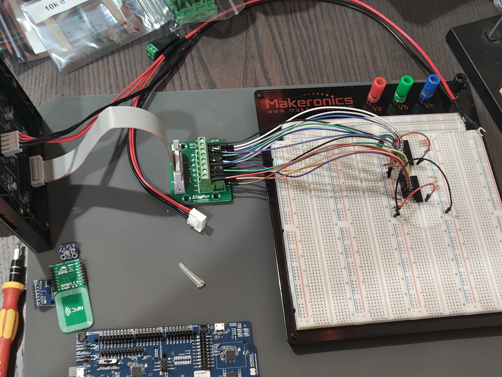

# DK prototype wiring

The bench uses a 64 × 64 P2 HUB75 panel through SN74AHCT245 buffers, with
breakout boards for the NFC tag, IMU and PDM microphone. The firmware draws a
32 × 32 window. Rev A has its own pin map; the
[devicetree overlay](../firmware/nrf5340_prototype/boards/nrf5340dk_nrf5340_cpuapp.overlay)
is the source of truth here.

  

| Signal | DK pin |
|---|---|
| HUB75 R1 / G1 / B1 | P1.11 / P1.12 / P1.13 |
| HUB75 CLK / LAT / OE | P1.14 / P1.15 / P1.08 |
| HUB75 A / B / C / D / E | P0.04 / P0.05 / P0.06 / P0.07 / P0.25 |
| IMU and NTAG SCL / SDA | P1.02 / P1.03 |
| IMU INT1 | P1.04 |
| NTAG field detect | P1.06 |
| PDM CLK / DATA | P1.07 / P1.09 |
| Timing bench SCK / MOSI / MISO | P0.08 / P0.09 / P0.10 |
| Timing bench LAT / BLANK / frame marker | P0.11 / P0.12 / P0.26 |

Power the panel from its own supply with a shared ground, and keep the level
shifters between the DK and the panel.

Leave DK Buttons 3 and 4 alone; those pins carry SPI signals. Don't open a
terminal on the DK's J-Link COM ports, because the interface MCU can then
drive shared pins (power-cycle the DK if you did). Use RTT for logs. SW6 in
nRF ONLY disconnects SWD as well.

The panel can't tell the MCU whether it's powered, so a running scan doesn't
prove anything is lit. Look at it.
