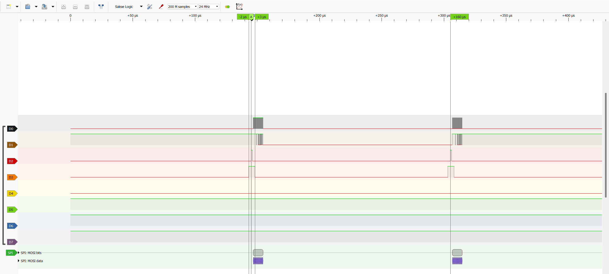

# DK scan timing bench

A standalone nRF5340 DK image that drives the scan signals with no matrix
attached, so they can be checked on a logic analyzer. It came before the
grayscale driver and the nRF52840, so it doesn't describe Rev A.

`firmware/nrf5340_prototype/bench/matrix_timing` uses TIMER1 for each 160 µs
row slot, driving SPIM4, LAT and BLANK through DPPI and GPIOTE. TIMER2 counts
32 rows and stops TIMER1. The CPU only restarts each frame, so a late
interrupt leaves the matrix dark rather than a row stuck on.

| Time in slot | Event |
|---|---|
| 1 µs | LAT high, latching the row shifted in the last slot |
| 2 µs | LAT low; SPIM4 shifts the next row (8 bytes at 8 MHz) |
| 4 µs | BLANK low, row on |
| 159 µs | BLANK high, row off |
| 160 µs | Next slot |

Each row is 32 row-select bits (0 turns that row's PFET on) and 32 column bits
(`A5`, row number, `5A`, inverted row number). RTT prints the frame rate once a
second, about 195 frames/s.



```powershell
.\scripts\dev.ps1 build -App firmware/nrf5340_prototype/bench/matrix_timing -BuildDir build/matrix_timing
```

Analyzer channels: SCK P0.08, MOSI P0.09, LAT P0.11, BLANK P0.12, frame
marker P0.26, and ground. A 24 MS/s analyzer decodes the 8 MHz shift and times
edges to about ±42 ns, but distorts the SCK duty cycle. Leave DK Buttons 3 and
4 alone and keep terminals off the DK's COM ports ([wiring](../prototype-wiring.md)).

[Results](../../validation/results/2026-10-09-dk-matrix-timing/README.md).
